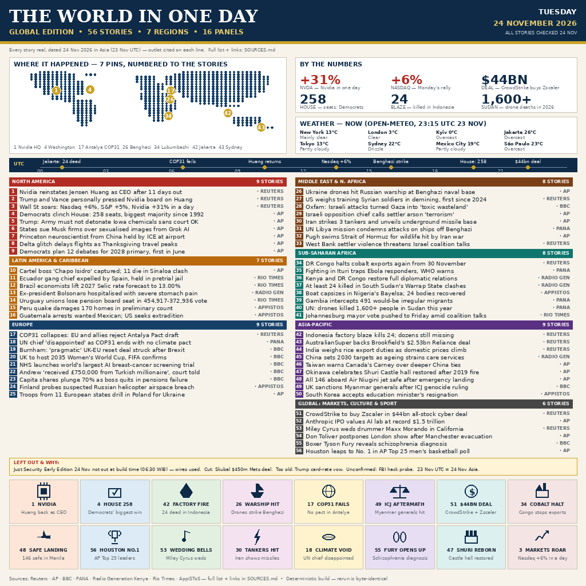

# The Global Edition — 24 November 2026

[](https://make.fun/bounty/news-image-20261124?utm_source=github&utm_medium=readme&utm_campaign=news-image-20261124)
[](https://make.fun/bounty/news-image-20261124/leaderboard?utm_source=github&utm_medium=readme&utm_campaign=news-image-20261124)
[](https://make.fun/bounty/news-image-20261124?utm_source=github&utm_medium=readme&utm_campaign=news-image-20261124)

**Tuesday 24 November 2026 — the whole world in one image.**



## What it is

One 1024×1024 poster summing up 24 November 2026's world news:

- **56 numbered stories across 7 regions** (North America 9, Latin America
  & Caribbean 7, Europe 9, Middle East & North Africa 8, Sub-Saharan
  Africa 8, Asia-Pacific 9, Global: Markets, Culture & Sport 6), each
  with its outlet cited on the poster.
- **Lead stories:** Nvidia reinstates Jensen Huang as CEO and Wall Street
  roars back (Nasdaq +6%); Ukraine drones hit a Russian warship at
  Benghazi; COP31 collapses with no climate pact.
- **16 illustrated panels** drawn from the day's stories, each with a
  hand-drawn pictogram.
- **Dot-matrix world map** with 7 numbered pins + legend.
- **UTC timeline** (7 timed events), **by-the-numbers** strip (6 stats),
  **weather strip** (current conditions for 8 cities, Open-Meteo) and a
  **"left out & why"** date-check box.

Every story was published in the 24 November 2026 news cycle (23 Nov
UTC = 24 Nov in Asia); full verification links are in
[SOURCES.md](SOURCES.md). The Just Security Early Edition for 24 Nov
was not yet published at build time (06:30 WIB; latest available
edition was 23 Nov), so stories were verified against Reuters, AP,
BBC, PANA, Radio Generation Kenya, Rio Times and AppiSToS.

## Regenerate

```sh
python3 main.py   # writes entry.png (1024x1024, deterministic)
```

Run it twice and the output is byte-identical (sha256
`9f26de7da70a9152add71bc74fa22d17bcea8e46884f628841231a4926604094`).
